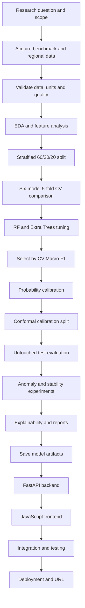

# AGROGUARD AI project flow

## Team allocation (maximum five groups)

1. Data and agricultural research: dataset, units, data audit, EDA, regional evidence.
2. ML experimentation: six models, cross-validation, tuning, evaluation.
3. Trust and explainability: calibration, conformal sets, anomaly detection, stability, feature importance.
4. Backend: FastAPI, validation, inference orchestration, logging, API tests.
5. Frontend and deployment: dashboard, warnings, results, responsive design, hosting, demonstration.

## Research contribution

The proposed contribution is an integrated trust-aware decision pipeline: calibrated class probabilities, conformal prediction sets, multivariate anomaly screening, perturbation-based stability analysis, and an explicit review/abstention state.

Do not claim that this is a new ML algorithm. The novelty is the integrated system design and its evaluation on appropriate data.
